# Misemio

**A personal recipe library that feels like a cookbook you made yourself.**
Warm paper, serif titles, a quiet sage palette, and nothing that nags you.

Misemio comes from *mise en place* ("everything in its place"). The app saves recipes from links, screenshots or your own hands. It helps you pick what to cook today, plan a week of meals and turn that plan into a grocery list.

<p>
  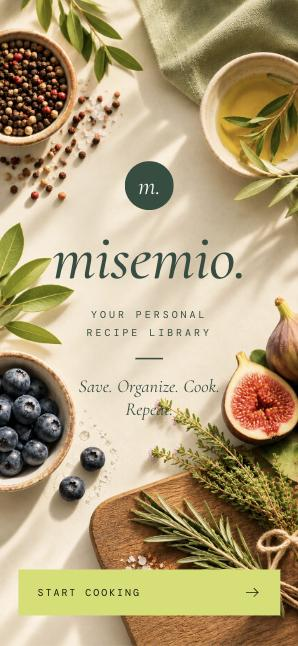
  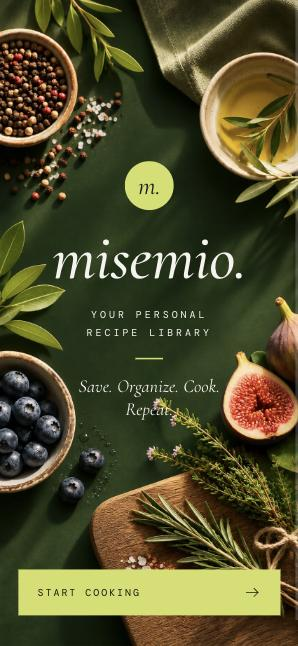
</p>
<p>
  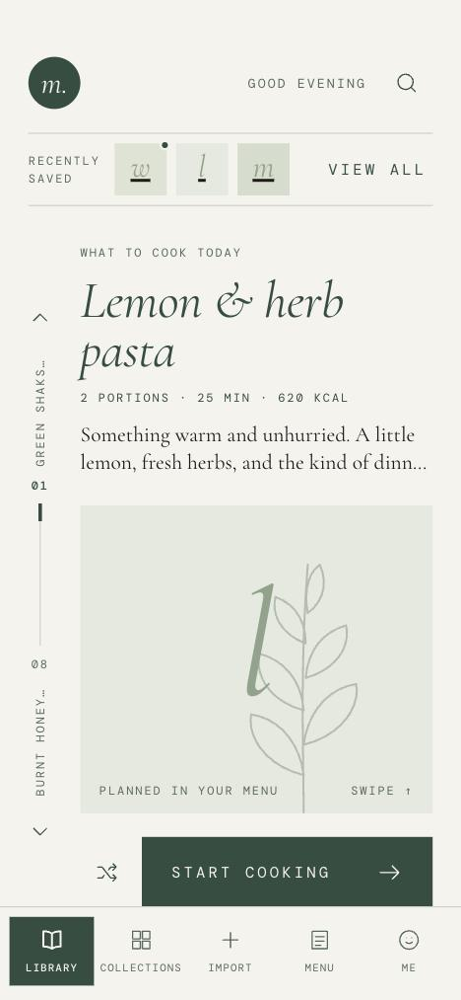
  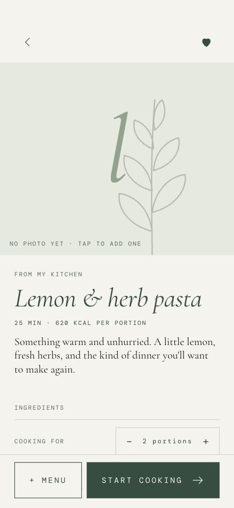
  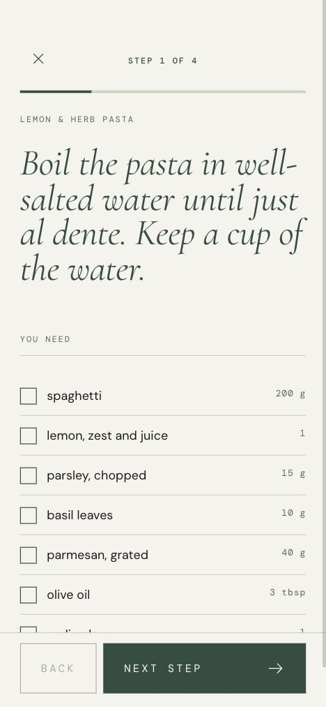
  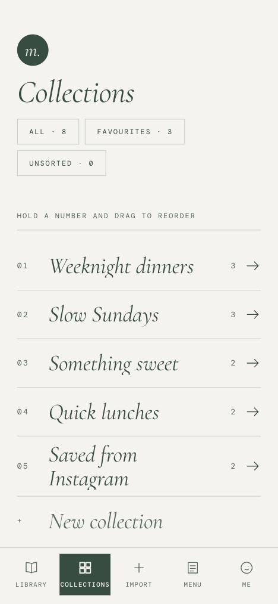
</p>
<p>
  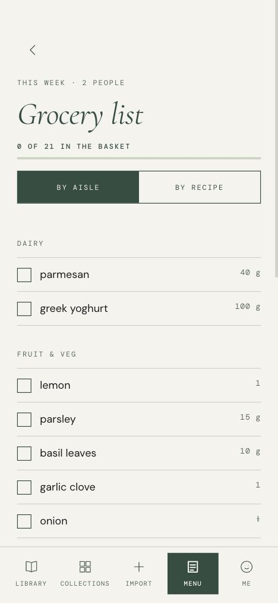
  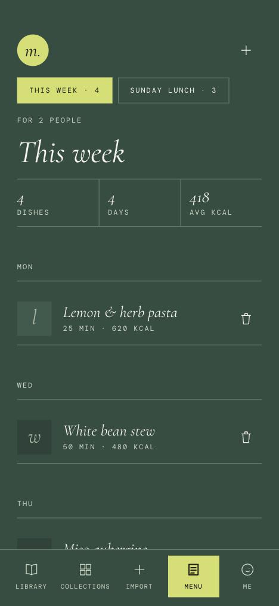
  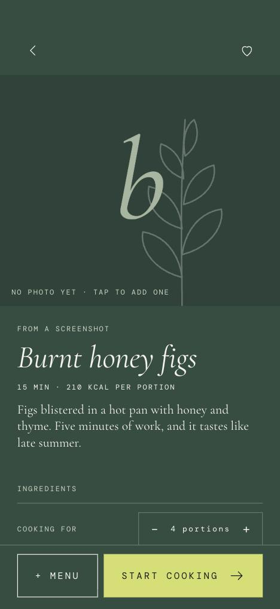
</p>

---

## What it does

| Screen | What you can do |
|---|---|
| **Splash** | The welcome screen when the app opens: a food still life (paper in light, deep green in dark), the monogram, the *misemio.* wordmark and "Save. Organize. Cook. Repeat." It animates in: the background settles, the monogram pops, the letters rise one by one, then the line, rule and button. Shown once per browser session; Start cooking or Esc closes it, and Me → Replay welcome screen brings it back. |
| **Library** | One "what to cook today" pick, ranked by what's planned, then saved this week, then favourites, then quick dishes, with the reason shown on the card. Scroll, swipe, use ↑ ↓ or the side rail to move to the next pick. |
| **Search** | Search by name, ingredient or note. Sort six ways (newest, A–Z, quickest, calories, protein, fewest ingredients) and filter by time, favourites, calories, protein or ingredient count. |
| **Recipe** | Scale portions and every amount updates. Nutrition per portion, your own notes, favourite, add to a menu on a chosen day. |
| **Cook mode** | One step at a time in large type with step progress. When a step names a time ("cover 6 minutes", "for two minutes"), a timer appears under it; a running timer follows you to other steps. Built to read from across the kitchen. |
| **Collections** | Your own shelves, laid out like a cookbook contents page. Drag the number (or use ↑ ↓ on the keyboard) to reorder. |
| **Import** | From a link, a screenshot or a blank page, always through a "check before saving" review. *(In this prototype the parsing is simulated.)* |
| **Menu → Grocery** | Plan meals by day for a number of people, then get one grocery list grouped by aisle or by recipe. Pantry staples are listed separately. |
| **Me** | Dark mode ("Dark kitchen"), and a one-tap JSON export of everything. Your recipes are yours. |

Changes are never confirmed with "Are you sure?". You act, and a toast offers **Undo** for 5 seconds.

---

## How it's built

The project is a **static web app with no build step and no dependencies**: plain HTML, CSS and JavaScript. Everything is organised around one rule: **screens are composed from a documented design system, and nothing bypasses it.**

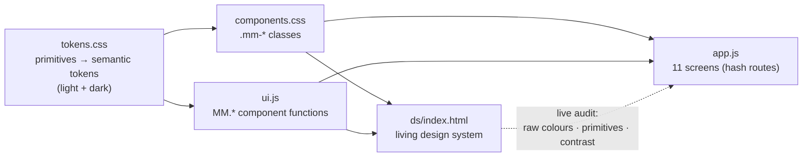

```
misemio/
├── index.html              app shell (fonts + 3 scripts)
├── assets/
│   ├── tokens.css          the ONLY file with raw values: primitives → semantic tokens, light + dark
│   ├── components.css      component classes (.mm-*), semantic tokens only
│   ├── ui.js               component functions (MM.button, MM.indexRow, MM.sheet, …)
│   ├── app.js              screens, state, actions, undo, drag-to-reorder
│   ├── data.js             sample library (8 recipes, 5 collections)
│   └── img/                splash backgrounds (light + dark)
├── ds/
│   └── index.html          design system page: renders the real components and audits the app
└── docs/
    ├── design-system.md    design system v1.0: rules, primitives, type, decisions
    └── screens/            screenshots
```

### Two-layer tokens

`tokens.css` is the single source of truth for colour, type, spacing, size and motion.

1. **Primitives** (`--mm-paper`, `--mm-deep-sage`, …) are raw values. Only semantic tokens reference them.
2. **Semantic tokens** (`--bg`, `--text`, `--text-2`, `--surface`, `--action-bg`, `--accent-bg`, `--selected-bg`, `--focus`, …) are the only names components and screens use.

Switching theme only swaps the semantic layer, so **every component gets dark mode automatically**.

### The design system page (`/ds`)

It isn't a static style guide. It loads the **same files the app uses**, so it can't drift:

- Each component is rendered live, with its usage signature and notes.
- The colour, type, spacing and icon specimens are generated from the tokens.
- A **contrast table** is computed in the browser for every text/background pair, in both themes.
- A **live audit** fetches `app.js`, `ui.js`, `components.css` and `index.html` and fails if any raw colour or `--mm-*` primitive appears outside `tokens.css`.

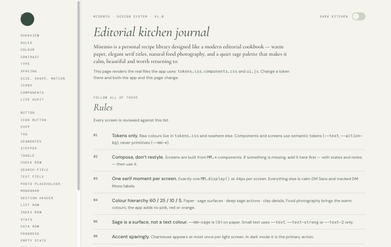

---

## Design system v1.0

### Palette: 60 / 25 / 10 / 5

| | Light ("Option B") | Dark ("Option C") |
|---|---|---|
| Background (60%) | Paper `#F6F3ED` | Deep Sage `#314E41` |
| Surfaces (25%) | Sage Pale `#E5E9DE` | Deep Sage 3 `#2A4338` |
| Actions (10%) | Deep Sage `#314E41` | Chartreuse `#D3DE66` |
| Details (5%) | Clay `#D7C4AF` | Fern `#5F7A6B` |
| Text | Ink `#1F1B18` · Moss `#556B57` | Paper · Hairline `#C9D4C0` |

Food photography brings the warm colour, so the UI itself uses **no pink, red or orange**. Sage `#A4B79F` is a surface only, never text (1.9:1 on paper).

### Type

- **Cormorant Garamond italic**: the display face, used for *one* 44px "serif moment" per screen plus editorial titles
- **DM Sans**: reading and controls (15 / 13)
- **DM Mono, uppercase, tracked 0.16em**: labels, buttons and tabs

### Shape, space, motion

Square corners everywhere (round only for the monogram, dots and toggles) · 4-pt spacing scale, 24px gutter · 44px minimum targets, 60px primary controls · 430px column · motion at 120 / 240 / 420ms, which drops to 0 with `prefers-reduced-motion`.

### Components (`MM.*`)

`button` · `iconButton` · `chip` / `chips` · `tag` · `segmented` · `stepper` · `toggle` · `check` · `timer` · `searchField` · `textField` · `photo` (letter + sprig placeholder) · `monogram` · `topbar` · `section` · `listRow` / `list` · `indexRow` · `stats` · `dataRow` · `progress` · `empty` · `tabbar` · `rail` · `sheet` / `option` · `toast` (undo) · `actionbar` · `splash`

### The rules every screen is checked against

1. **Tokens only.** Raw values live in `tokens.css`; nothing else uses primitives.
2. **Compose, don't restyle.** A missing component is added to `/ds` first (preview, usage, notes), then used.
3. **One serif moment per screen**: exactly one `MM.display()` at 44px.
4. **Colour hierarchy 60/25/10/5**, with no pink, red or orange in the UI.
5. **Sage is never text.**
6. **Accent (chartreuse) at most once per light screen**; it becomes the primary action in dark mode.
7. **Square corners.**
8. **44px targets, named icon buttons, visible focus.**
9. **Contrast AA minimum, AAA for body text**, in both themes.
10. **Undo, not confirm.**
11. **Explain defaults; no guilt, no streaks.** Progress is shown only for the task in hand.
12. **Export always available. Respect reduced motion.**

The full spec is in [`docs/design-system.md`](docs/design-system.md).

---

## Process and decision log

The work was done in small, checked steps. Each change goes through the design system first and then gets verified in the browser.

| Step | What happened |
|---|---|
| **Design system v1.0** | Defined primitives, semantic tokens, type, spacing and 24 components; built `/ds` with live rendering, a contrast table and a code audit. |
| **Audit against the rules** | Swept 11 routes in both themes for serif moments, accent usage, corner radius, target size, accessible names and contrast. Found three deviations. |
| **Fix: Search** | Had no serif moment. Added one `MM.display('Search')`. |
| **Fix: Cook mode** | Used a hand-built 32px display. Moved to `MM.display()` at 44px inside an `aria-live` region, so each new step is announced. |
| **Fix: dark surfaces** | Body text on `--surface` was 6.89:1 (AA only). Moved dark `--surface` to Deep Sage 3, giving **9.68:1 (AAA)**. |
| **Decision: Collections layout** | Compared three options (list with covers, index without photos, peek). Chose **Option 2, an index without photos**: it's the fastest to scan and the most editorial. Added `MM.indexRow` to the design system first, then rebuilt the screen. The number doubles as the drag handle. |

| **Feedback round (artifact comments)** | Cook mode shows only the current step, plus a new `MM.timer` for any step that names a time. On Library you scroll to the next pick, and shuffle is gone. |
| **Splash screen** | Light and dark backgrounds became tokens (`--splash-bg`), with the logotype size (`--type-wordmark`) and a hero motion duration (`--dur-hero`). Added `MM.splash` to `/ds` with a replayable preview, then showed it when the app opens. Every timing is a motion token, so reduced motion shows it instantly. |

Every step ends with the `/ds` live audit showing **PASS** for every file.

---

## Accessibility

- AAA contrast for body text in light and dark, AA for all secondary text, checked live on `/ds`
- 44 × 44px minimum targets; chips extend their hit area invisibly
- Every icon button has an accessible name; focus is always visible (`--focus`)
- Drag-to-reorder has a keyboard equivalent (↑ ↓ on the focused number)
- Cook mode steps are announced with `aria-live`
- All motion tokens go to 0 under `prefers-reduced-motion`

---

## Run it locally

No install is needed.

```bash
python3 -m http.server 8000
```

- App: <http://localhost:8000>
- Design system: <http://localhost:8000/ds/>

After any change, open `/ds` and check that the **Live audit** shows PASS everywhere.

---

## Status

This is a working **prototype**. Data lives in your browser's `localStorage` (export it any time from **Me**). The library starts with eight sample recipes, and parsing from links and screenshots is simulated.
