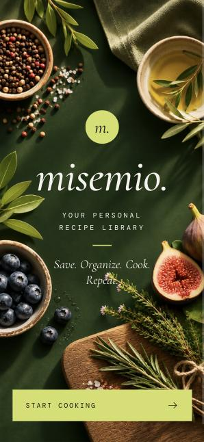
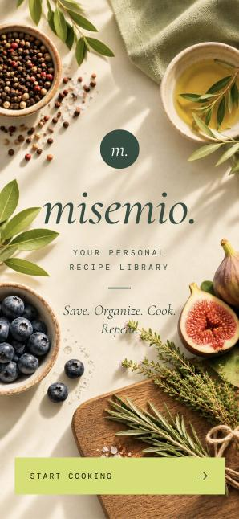
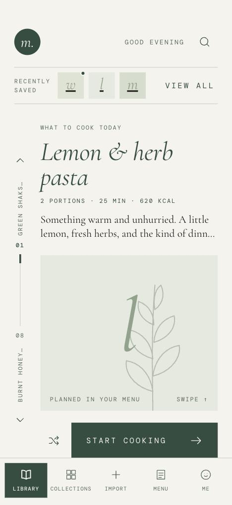
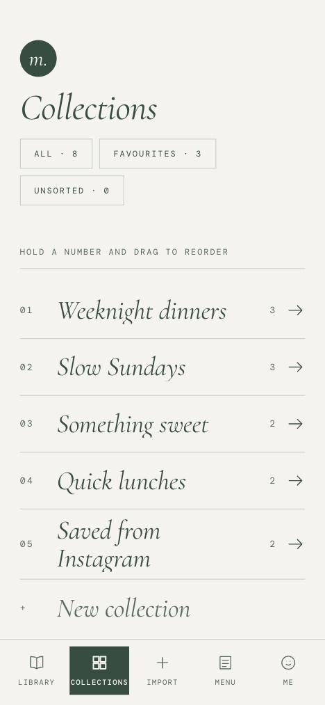
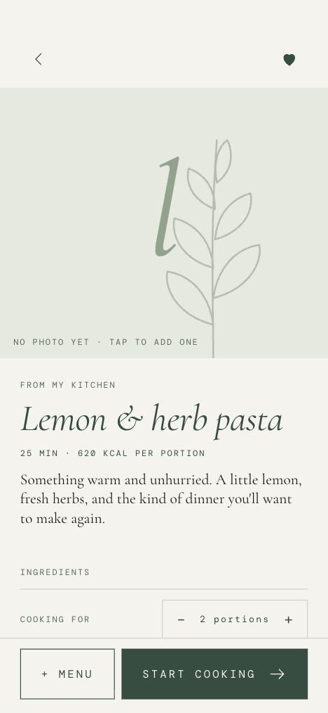
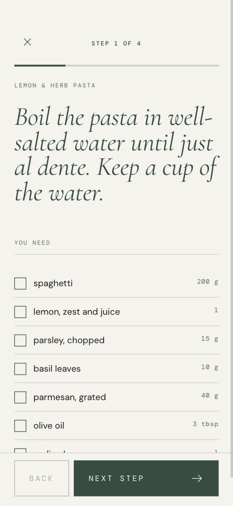
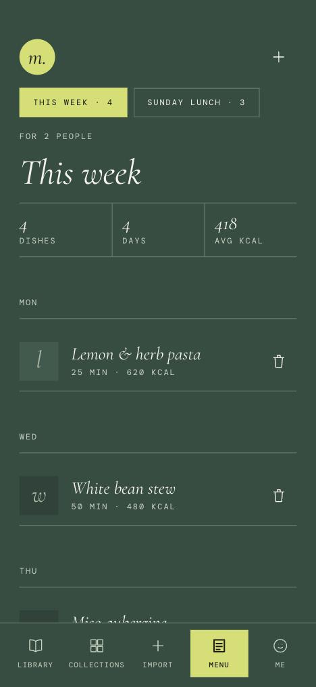
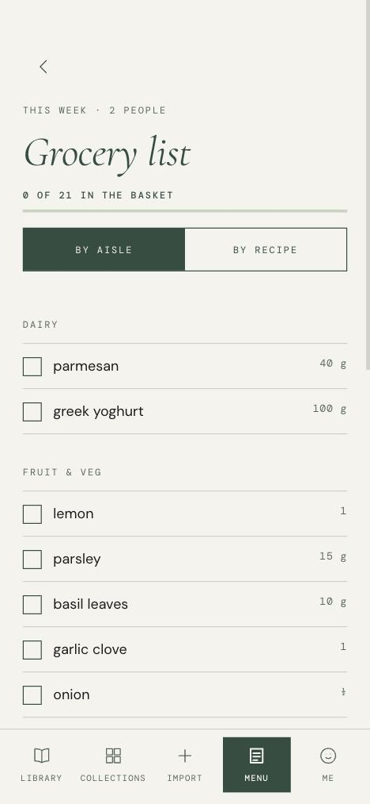
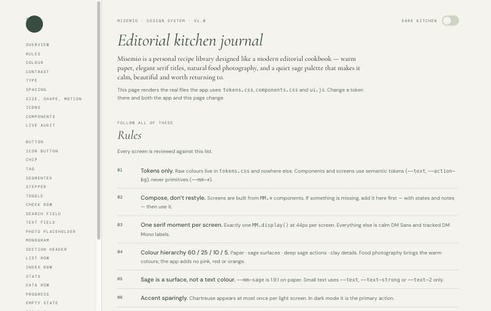

# Misemio — From scattered recipes to a personal cookbook

**Independent product · Product design + front-end prototype · In development**

> **Every recipe worth keeping.** Misemio turns recipes collected across websites, screenshots, and personal notes into a calm, searchable recipe library. The concept is designed around saving first, organizing later, and enjoying cooking without the friction of finding that one recipe again.

[View prototype preview (in development)](https://olesyalevytskaua-ops.github.io/misemio/) · [Browse the design system](../ds/) · [See the source](https://github.com/olesyalevytskaua-ops/misemio)



## 01 / Origin — Why another recipe app?

Recipes are easy to discover but surprisingly easy to lose. A recipe might be in a screenshot, an article, a chat message, or handwritten notes. The problem isn't finding more inspiration; it's **turning saved inspiration into something you can actually cook**.

**Design question:** How might we create a personal, beautiful cookbook from fragmented recipes without forcing people to categorize everything before saving it?

This project began as a personal product idea, not a claim of completed market research or validated demand.

## 02 / Product principles

1. **Save first, organize later.** Importing shouldn't require a collection or a long form.
2. **Your cookbook, your categories.** Users create, name, rename, and rearrange collections like Pinterest boards.
3. **Readable at the stove.** Steps should be clear, high-contrast and usable with messy hands and divided attention.
4. **The recipe belongs to the user.** Editing, notes, export, and user-controlled organization come before social feeds.
5. **Editorial, never ornamental at the expense of usability.** One typographic hero moment; clear controls everywhere else.

## 03 / Primary journeys

### Capture → review → save
**Link / screenshot / manual entry → Review extracted draft → Edit recipe → Save → Optional collection**

The interaction is designed so users remain in control of titles, ingredients, quantities, steps, and source information. **Important prototype limitation:** parsing is currently simulated; automated extraction from real screenshots and websites is a future integration.

### Rediscover → cook
**Library / Search / Collection → Recipe → Adjust servings → Cook mode → Follow steps and optional timers**

### Organize like Pinterest
**Create collection → Name it freely → Save recipes → Reorder collections → Revisit anytime**

No forced preset names such as Breakfast or Dinner. One recipe can be conceptually grouped in several personal themes; confirm the exact many-to-many implementation before describing it as shipped.

## 04 / Art direction — a cookbook, not a dashboard

Our primary reference is a refined editorial journal: oversized italic serif type, tracked mono labels, generous negative space, warm paper, and deliberate asymmetry. The visual system uses natural food still lifes to bring color and emotional warmth.

| Token | Light | Dark |
|---|---|---|
| Background | Warm Paper `#F6F3ED` | Deep Sage `#314E41` |
| Supporting surfaces | Sage Pale `#E5E9DE` | Deep Sage 3 `#2A4338` |
| Primary action | Deep Sage `#314E41` | Fresh Chartreuse `#D3DE66` |
| Detail | Clay `#D7C4AF` | Fern `#5F7A6B` |
| Typography | Cormorant Garamond + DM Sans + DM Mono | Same |

The logo is intentionally simple: *misemio.* with an italic editorial wordmark and a compact `m.` monogram. The splash screens use photorealistic herbs, berries, spices, figs and olive oil around a clear central space.




## 05 / UI explorations and prototype

| Library | Collections |
|---|---|
|  |  |

| Recipe | Cook mode |
|---|---|
|  |  |

| Menu, dark mode | Grocery list |
|---|---|
|  |  |

The repository contains **static HTML/CSS/JavaScript UI implementation in progress**, with designed screens and code for the library, search, recipe details, portion scaling, cook mode, collections, import review, weekly menu, grocery list, light/dark themes and JSON export. **The prototype is not yet working reliably**, and these features must not be considered fully functional or validated until tested. See [README](../README.md) for the current feature-by-feature implementation notes.

### Foldable cookbook prototype

The edge-to-edge cover reworks the welcome screen’s fruit, herbs and warm light for the proportions of the iPhone Duo displays. The owner’s name sits below the Misemio wordmark and is saved in the browser. Opening the cover becomes the interaction that takes you into the book.

| View | What the reader sees |
|---|---|
| Compact, cover closed | The cover and an explicit **Open cookbook** action |
| Expanded from the cover | A contents page on the left and recipes in the active collection on the right |
| Compact, after selecting a collection | The same collection’s recipes in a single column |

The interaction uses the available browser viewport. CSS lays out the contents and recipe pages side by side at 600 × 480 CSS pixels or larger. JavaScript listens for the same media query to open the book when the viewport first crosses that threshold while the cover is visible.

```js
window.matchMedia('(min-width: 600px) and (min-height: 480px)').addEventListener('change', (event) => {
  if (event.matches && route().name === 'cover' && !document.querySelector('.mm-splash')) go('#collections');
});
```

The collection lives in the URL hash, so changing viewport sizes preserves the selection. A tap or keyboard activation on the cover opens the cookbook at any size. See the [JavaScript](../assets/app.js) and [responsive CSS](../assets/components.css).

**Validation.** Open the cover at a compact viewport, then expand to 850 × 640 CSS pixels. Select a collection and reduce the viewport to verify the recipe list stays on that collection. This interaction was checked in Chromium with simulated viewport changes. Safari behaviour on physical iPhone Duo hardware remains to be verified.

## 06 / Design system and accessibility

The interface uses documented primitive and semantic tokens, reusable `MM.*` components, and a living [design system](../ds/) that renders actual components and checks contrast and token usage. The design rules include keyboard-accessible reordering, at least 44px interaction targets, visible focus, reduced motion, and contrast-conscious text combinations. Accessibility checks and assertions in the repository are not substitutes for independent device and assistive-technology testing.



## 07 / Decisions and trade-offs

- **Editorial collections over decorative image tiles:** chose a numbered contents-page treatment for fast scanning and character.
- **One featured recipe instead of a feed of content:** direct attention to choosing what to cook rather than maximizing scrolling.
- **Review extracted content before saving:** avoids treating uncertain parsing as an unquestionable result.
- **No sign-up barrier in the prototype:** reduces friction, but requires clear local-data and export expectations.
- **Separate cook mode:** the readable step is more important than showing an entire recipe while cooking.

## 08 / Next validation

The design hypotheses still need testing with actual users and real imported recipes. Priorities include extraction accuracy from screenshots and links, correction effort, recipe findability, whether editorial collections outperform image-heavy boards, portion scaling correctness, and kitchen usability of the cook-mode controls.

**Status:** Design concept and in-development front-end prototype. The prototype does not yet work reliably, and recipe parsing is simulated. Screens document the intended UI, not proof of a usable production app.

---

*Independent concept and product design by Olesya Levytska. Case study updated November 2026.*
